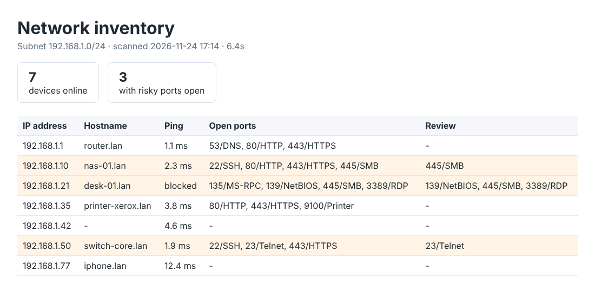

# network-scanner

Scans a subnet and tells you what's on it: which IPs are up, their hostnames, and what ports they have open. It can save the results to a CSV or an HTML report.



## Why

At my last job I was walking into a different client site almost every week, and the first thing I always needed to know was what was already on the network. Half the time nobody had an up-to-date list. I wanted something quick I could run from a laptop that would give me that list and point out stuff worth looking at, like Telnet still enabled on a switch or RDP open on a desktop.

## What it does

- Pings every address in the subnet. Windows machines block ping by default, so if a device doesn't answer ping but has a port open, it still counts as up.
- Looks up the hostname with reverse DNS
- Checks common ports (SSH, Telnet, DNS, HTTP/HTTPS, SMB, RDP, printer ports, etc.)
- Flags Telnet, NetBIOS, SMB and RDP so you can review them
- Checks 100 addresses at a time, so a /24 takes a few seconds
- Saves to CSV and/or HTML

Only uses the Python standard library, so there's nothing to pip install. Works on Windows, Mac and Linux (Python 3.8+).

## How to run it

```bash
git clone https://github.com/<your-username>/network-scanner.git
cd network-scanner
python netscan.py 192.168.1.0/24 --csv inventory.csv --html report.html
```

To find your subnet, run `ipconfig` (Windows) or `ifconfig` (Mac/Linux). If your IP is 192.168.1.57, your subnet is most likely 192.168.1.0/24.

Options:

```
python netscan.py NETWORK [--ports 22,80,443] [--csv FILE] [--html FILE]
                          [--workers 100] [--no-tcp-fallback]
```

- `--ports` pick which ports to check (defaults to the common ones above)
- `--csv` / `--html` save the results
- `--workers` how many addresses to check at once (default 100)
- `--no-tcp-fallback` only count devices that reply to ping

It won't scan anything bigger than a /20.

## Example

```
Scan of 192.168.1.0/24: 7 device(s) online (6.4s)

IP ADDRESS       HOSTNAME                           PING  OPEN PORTS
--------------------------------------------------------------------------------
192.168.1.1      router.lan                       1.1 ms  53/DNS, 80/HTTP, 443/HTTPS
192.168.1.10     nas-01.lan                       2.3 ms  22/SSH, 80/HTTP, 443/HTTPS, 445/SMB  <-- check: 445
192.168.1.21     desk-01.lan                     blocked  135/MS-RPC, 139/NetBIOS, 445/SMB, 3389/RDP  <-- check: 139, 445, 3389
192.168.1.35     printer-xerox.lan                3.8 ms  80/HTTP, 443/HTTPS, 9100/Printer
192.168.1.50     switch-core.lan                  1.9 ms  22/SSH, 23/Telnet, 443/HTTPS  <-- check: 23
```

That data is made up. Sample CSV and HTML files are in `sample_output/`.

## Tests

```bash
python -m unittest discover tests
```

## Note

Only scan networks you own or have permission to scan.

## Things I want to add

- MAC address and vendor lookup
- Comparing two scans to see what's new or missing
- Running on a schedule and emailing when a new device shows up
